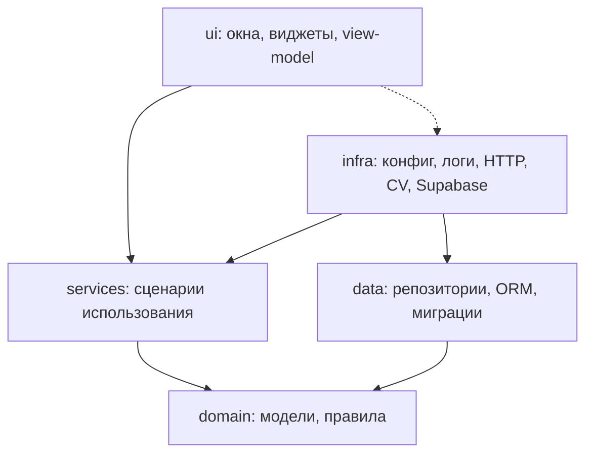
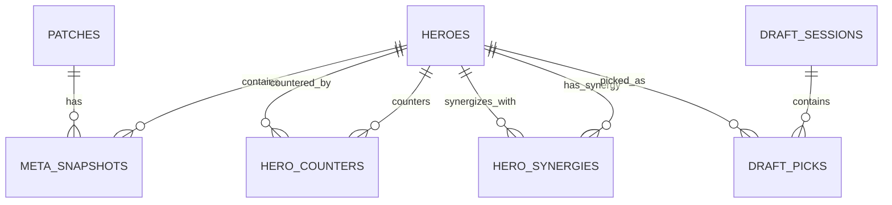

# VETMO — Implementation Plan

**Project:** VETMO (Dota 2 All Pick draft assistant)  
**Date:** 2026-10-19  
**Deadline:** 2026-10-21 (Wednesday)  
**Spec:** `docs/plans/2026-10-19-vetmo-spec.md`  
**Author:** Plan Architect agent  
**Status:** Ready for review

---

## 1. Шапка

**Цель:** Создать десктопного помощника в драфте Dota 2 (All Pick) за 2 дня: главное окно с новостями/мета, настройки оверлея, темы/обои, кнопка оверлея, оверлей с рекомендациями героев по позициям 1–5 для обеих команд, локальная БД с данными из OpenDota API, опциональная синхронизация в Supabase, экспериментальный компьютерное зрение для распознавания пиков.

**Архитектура:** Многослойное десктопное приложение на Python + PySide6. Слои: `domain` (чистые модели и бизнес-правила), `data` (репозитории, SQLAlchemy ORM, Alembic миграции), `services` (сценарии использования: OpenDota клиент, драфт-сервис, сервис оверлея, CV-сервис, новостной сервис), `ui` (окна, виджеты, view-model без Qt-импортов в lower слоях), `infra` (конфиг, логирование, HTTP-клиент). Зависимости направлены внутрь: `ui → services → domain`, `data → domain`. Бизнес-логика не в виджетах и не в SQL.

**Стек:** Python 3.11+, uv, PySide6, SQLAlchemy 2.x, Alembic, pydantic-settings, requests/httpx, OpenCV + mss (экспериментальный CV), pytest, pytest-qt, ruff, mypy, PyInstaller (one-file exe). Локальная БД: SQLite (WAL). Опциональное облако: Supabase (REST клиент, не первичное хранилище).

**Путь к спецификации:** `docs/plans/2026-10-19-vetmo-spec.md`

**Глобальные ограничения:**
- Язык UI: русский.
- Секреты не коммитятся (`.env` в `.gitignore`, `.env.example` в репозиторий).
- OpenDota API rate limit не превышается; данные кэшируются ≥ 24 ч.
- Оверлей: без рамки, always-on-top, прозрачный, click-through, не крадёт фокус из Dota 2.
- Локальная SQLite — источник истины; Supabase — опциональная синхронизация.
- n8n не реализуется в этой итерации (оформлен как будущий webhook-хук).
- Упаковка: один файл `.exe` через PyInstaller.

**Review Focus (5 вероятных сбоев + тест на каждый):**
1. OpenDota вернёт некорректные данные (имя героя не exists, winrate вне 0–100) → тест `test_validator_quarantines_invalid_hero_record` в T-007.
2. Оверлей перекрывает экран выбора героев и крадёт фокус у Dota 2 → тест `test_overlay_flags_always_on_top_no_focus_steal` в T-013.
3. Повторная синхронизация создаёт дубликатов героев в БД → тест `test_sync_heroes_idempotent_upsert` в T-004.
4. Сетевая ошибка роняет GUI → тест `test_news_service_network_error_shows_offline_state_not_crash` в T-008.
5. CV находит не тот герой на пике (ложное положительное срабатывание) → тест `test_cv_match_requires_min_confidence_and_allows_manual_override` в T-016.

---

## 2. Обзор и цели

**Проблема:** В All Pick драфте Dota 2 игрокам нужно быстро выбирать контрапики и синергии под позиции 1–5, но встроенной подсказки по мету иcontre-пикам нет. Игроки переключаются между браузером и игрой, теряя время.

**Ценность:** VETMO даёт оверлей поверх игры с рекомендациями героев по позициям для обеих команд, основываясь на актуальных данных OpenDota (винрейты, контрпики, синергии), с возможностью ручного ввода пиков если CV не справилось.

**Метрики успеха (к среде):**
- Холодный старт приложения < 3 с.
- Оверлей отображает ≥ 1 героя на каждую позицию 1–5 для Radiant и Dire.
- Локальная БД содержит 120+ героев и мету после первой синхронизации.
- Приложение собирается в один `.exe` и запускается на чистом Windows.
- API-данные проходят валидацию перед показом пользователю.

---

## 3. Область работ

**In scope:**
- Windows desktop app (PySide6).
- Главное окно (launcher): новости по патчам, мета, настройки оверлея, выбор темы/обоев, кнопка запуска оверлея.
- Оверлей: borderless, always-on-top, прозрачность, две колонки (Radiant слева, Dire справа), позиции 1–5 с карточками героев.
- Машина состояний драфта: 2 пика → 2 пика → 1 пик (всего 10 пиков, 5 на команду).
- Локальная SQLite + SQLAlchemy 2.x + Alembic миграции с первого дня.
- OpenDota API клиент с кэшированием, upsert, ретраями, уважением rate limit.
- Валидатор API-данных (отдельный сервис, проверяет соответствие реальности).
- Ручной ввод пиков (диалог выбора героя) как fallback к CV.
- Экспериментальный CV: захват экрана (mss) + шаблонное совпадение иконок героев (OpenCV).
- Опциональный Supabase клиент (заглушка, не блокирует старт без учётных данных).
- Тесты: unit + интеграционные, pytest, pytest-qt.
- PyInstaller one-file сборка `.exe`.
- README с инструкцией запуска и сборки.

**Out of scope (deferred):**
- n8n интеграция (оформлен как будущий webhook-хук в `infra/hooks/n8n_stub.md`).
- Supabase как первичная БД (только опциональный клиент).
- Парсинг памяти или сетевого пакета Dota 2 (только экранный захват).
- Аккаунты, авторизация, облачные профили пользователей.
- Мобильная, macOS, Linux версия.
- Звуковые оповещения, голосовые команды.
- Автоматическое определение текущего шага драфта из игры (ручной ввод шага).

**Допущения:**
- OS: Windows 10/11.
- Dota 2 запущена в windowed/borderless режиме (CV требует захват экрана).
- OpenDota API доступен без ключа, rate limit ~60 req/мин.
- Supabase URL/key могут отсутствовать — приложение не должно падать.
- Иконки героев скачиваются один раз и хранятся локально для CV.

**Открытые вопросы:**
- Будет ли пользователь предоставлять Supabase URL/key?
- В каком режиме (окно/полноэкран) будет Dota 2 во время драфта?
- Нужно ли отображать пики команды противника (Dire) или только свои рекомендации?

---

## 4. Пользователи и сценарии

| Роль | Кто | Сценарии |
|---|---|---|
| Игрок | Dota 2 игрок | Открывает приложение, читает новости/мета, настраивает оверлей, запускает его во время драфта, следует рекомендациям по позициям. |
| Продвинутый пользователь | Тот же игрок | Меняет положение/прозрачность оверлея, тему/обои, вручную корректирует пики если CV ошибся, проверяет свежесть данных. |

**User stories с acceptance criteria:**
- US-001: Как игрок, я хочу видеть новости по патчам при открытии, чтобы знать текущий мета. AC: окно показывает ≥1 новость за <3 с.
- US-002: Как игрок, я хочу настроить положение и прозрачность оверлея, чтобы он не мешал игре. AC: настройки сохраняются и применяются при следующем запуске.
- US-003: Как игрок, я хочу видеть рекомендации героев для позиций 1–5 по обеим сторонам, чтобы выбирать контрпики. AC: оверлей показывает карточки героев с иконками и именами.
- US-004: Как игрок, я хочу вручную внести пик, если автоматика не распознала. AC: диалог выбора героя обновляет состояние драфта и рекомендации.
- US-005: Как игрок, я хочу запустить приложение одним `.exe`, чтобы не устанавливать Python. AC: один файл установки, ярлык в Пуск.

---

## 5. Требования

| ID | Требование | Критерий проверки |
|---|---|---|
| FR-001 | Лаунчер: новости, мета, настройки оверлея, темы/обои, кнопка оверлея | Окно появляется <3 с; содержит ≥1 новость, кнопку оверлея, селектор тем |
| FR-002 | Настройки оверлея: позиция, прозрачность, always-on-top, click-through | Настройки сохраняются в SQLite и восстанавливаются |
| FR-003 | Кнопка оверлея: показать/скрыть без закрытия лаунчера | Клик переключает видимость оверлея |
| FR-004 | Оверлей: рекомендации героев позиций 1–5, Radiant слева, Dire справа | ≥1 карточка героя на каждую позицию для обеих команд |
| FR-005 | Машина состояний драфта: 2-2-1 пика, индикатор шага | Шаг продвигается корректно, максимум 10 пиков |
| FR-006 | Синхронизация с OpenDota: héros, винрейты, пик-рейты, контрпики, синергии | После синхрона БД содержит 120+ героев |
| FR-007 | Валидатор API-данных: проверка имён героев, диапазонов, URL иконок | Невалидные записи карантинятся, не показываются |
| FR-008 | Ручной ввод пиков (fallback CV) | Диалог обновляет драфт и рекомендации |
| FR-009 | CV: захват экрана + шаблонное совпадение иконок | Модуль не падает; найденные пики можно подтвердить/исправить |
| FR-010 | Опциональный Supabase клиент | Приложение запускается без учётных данных Supabase |
| FR-011 | Упаковка: один .exe | PyInstaller собирает one-file, запускается на чистом Windows |

| ID | Требование | Критерий проверки |
|---|---|---|
| NFR-001 | Холодный старт < 3 с | Замер `time` от двойного клика до первого окна |
| NFR-002 | Оверлей не крадёт фокус у Dota 2 | Визуальная проверка на Windows 10/11 |
| NFR-003 | Rate limit OpenDota соблюдается; кэш ≥ 24 ч | Не более 60 запросов/мин; офлайн-режим работает |
| NFR-004 | UI на русском | Все строки пользователя на русском |
| NFR-005 | Разделение UI ↔ ViewModel ↔ Service; никакого SQL/API в ui/ | Code review |
| NFR-006 | Секреты через `.env` + pydantic-settings; `.env` в `.gitignore` | `.env.example` есть, `.env` игнорируется |

---

## 6. Архитектура

**Слои и правила зависимостей:**
```
ui (PySide6 окна, виджеты, view-model)
  ↑
services (сценарии использования, оркестрация)
  ↑
domain (чистые модели: Hero, Patch, MetaSnapshot, DraftSession, Pick; без I/O)
  ↑
data (репозитории, SQLAlchemy модели, Alembic миграции) → domain
  ↑
infra (конфиг, логирование, HTTP клиент, CV, Supabase stub)
```

Никаких импортов Qt в `domain`/`data`. Никакого SQL в `ui`. Бизнес-логика не в виджетах.

**Диаграмма зависимостей (Mermaid):**


**Структура каталогов:**
```
src/vetmo/
  __init__.py
  domain/          # чистые модели и правила, без I/O
    models.py      # Hero, Patch, MetaSnapshot, DraftSession, Pick, Position
    rules.py       # драфт-последовательность 2-2-1, логика рекомендаций
  data/            # репозитории, ORM, миграции
    db.py          # SQLAlchemy engine, сессия, WAL
    models_orm.py  # таблицы ORM
    repositories/  # HeroRepository, MetaRepository, DraftRepository, SettingsRepository
    migrations/    # Alembic версии
  services/        # сценарии использования
    opendota_client.py   # HTTP клиент OpenDota, кэш, ретраи
    validator_service.py # ПРОВЕРКА ДАННЫХ ПРОТИВ РЕАЛЬНОСТИ (отдельный агент)
    draft_service.py     # машина состояний драфта
    overlay_service.py   # управление оверлеем
    news_service.py      # новости/мета
    cv_service.py        # компьютерное зрение (эксперимент)
    settings_service.py  # настройки оверлея, темы
  ui/              # окна, виджеты, view-model (без Qt в lower слоях)
    main_window.py     # лаунчер: новости, мета, настройки, кнопка оверлея
    overlay_window.py    # оверлей: позиции 1–5, Radiant/Dire
    settings_dialog.py   # настройки оверлея и тем
    manual_pick_dialog.py# ручной ввод пика
    widgets/           # карточки героев, индикатор шага драфта
    viewmodels/        # без импортов Qt
  infra/           # конфиг, логи, HTTP, CV, Supabase
    config.py      # pydantic-settings, .env
    logging.py     # настройка логирования
    http_client.py # обёртка над httpx с ретраями
    supabase_stub.py # опциональный клиент (заглушка)
    n8n_hook_stub.md # будущий вебхук (не реализуется)
tests/
  unit/
  integration/
  conftest.py
docs/
  plans/
```

---

## 7. Модель данных

**Таблицы (SQLAlchemy 2.x, Alembic):**

| Таблица | Колонки | Тип | PK/FK | Индексы |
|---|---|---|---|---|
| `heroes` | id, name, localized_name, primary_attr, attack_type, roles, icon_url, is_validated | Integer PK, String, String, String, String, JSON, String, Boolean | PK id | ix_heroes_name, ix_heroes_is_validated |
| `patches` | id, version, release_date, note | Integer PK, String, Date, Text | PK id | ix_patches_version |
| `meta_snapshots` | id, patch_id, hero_id, win_rate, pick_rate, created_at | Integer PK, FK→patches.id, FK→heroes.id, Float, Float, DateTime | PK id | ix_meta_snapshot_patch_hero |
| `hero_counters` | id, hero_id, counter_hero_id, win_rate_against, sample_size | Integer PK, FK→heroes.id, FK→heroes.id, Float, Integer | PK id | ix_counters_hero_pair |
| `hero_synergies` | id, hero_id, synergy_hero_id, win_rate_with, sample_size | Integer PK, FK→heroes.id, FK→heroes.id, Float, Integer | PK id | ix_synergies_hero_pair |
| `user_settings` | id, key, value | Integer PK, String, String | PK id | ix_settings_key |
| `draft_sessions` | id, started_at, finished_at, current_step, total_picks | Integer PK, DateTime, DateTime, Integer, Integer | PK id | |
| `draft_picks` | id, session_id, team, position, hero_id, picked_at | Integer PK, FK→draft_sessions.id, String, Integer, FK→heroes.id, DateTime | PK id | ix_picks_session_team |

**Ограничения целостности:**
- `hero_counters`: unique(hero_id, counter_hero_id)
- `hero_synergies`: unique(hero_id, synergy_hero_id)
- `win_rate` между 0 и 100 (Check constraint)
- `position` между 1 и 5 (Check constraint)

**ER-диаграмма (Mermaid):**


**Стратегия миграций:** Alembic с первого дня, версия `0001_initial`. Upsert для héros и мета через `ON CONFLICT` (SQLite) / `ON CONFLICT` (PostgreSQL при необходимости).

**Seed-данные:** Первичная загрузка héros из OpenDota при первом запуске (T-004).

---

## 8. Внешние интеграции

| Интеграция | Детали |
|---|---|
| OpenDota API | `https://api.opendota.com/api/` — герои, мету, контрпики, синергии. Rate limit ~60 req/мин. Кэш в SQLite ≥ 24 ч. Ретраи с экспоненциальной задержкой (3 попытки). |
| Supabase | Опциональный REST клиент. Если `SUPABASE_URL`/`SUPABASE_KEY` не заданы — приложение не падает, работает офлайн. Синхронизация мета-снэпшотов (в одну сторону: отправка). |
| n8n | Не реализуется. Заглушка `infra/n8n_hook_stub.md` dokumentuje будущий webhook для уведомлений. |
| CV (OpenCV + mss) | Захват экрана, шаблонное совпадение иконок héros (скачаны с OpenDota). Эксперимент, ручной ввод приоритетнее. |
| Логирование | `logging` в файл + консоль, ротация, уровень через `.env`. |
| Конфиг | `pydantic-settings`, `.env`, `.env.example`. |

**Правовые ограничения:** Использование только публичного OpenDota API, соблюдение условий использования, kein парсинг сайтов, kein обход лимитов.

---

## 9. GUI

**Экраны:**
1. **MainWindow (лаунчер):** левая панель — новости/патчи; центр — мета (топ героев по винрейту); правая панель — настройки оверлея (позиция, прозрачность, always-on-top, click-through), выбор темы/обоев, большая кнопка "Запустить оверлей"; нижняя панель — статус синхронизации, версия.
2. **OverlayWindow:** borderless, always-on-top, прозрачный фон, click-through. Две колонки: Radiant (слева) и Dire (справа). В каждой колонке 5 позиций (1–5) с карточками héros (иконка, имя, винрейт, причина рекомендации). Индикатор текущего шага драфта (2-2-1).
3. **SettingsDialog:** модальное или встроенное в лаунчер — настройки оверлея, темы, обновление данных.
4. **ManualPickDialog:** выбор героя из списка для ручного ввода пика.
5. **CV Calibration (опционально):** выбор зон пиков на экране.

**Навигация:** Лаунчер → кнопка оверлея → показать/скрыть оверлей. Настройки доступны из лаунчера. Ручное редактирование пиков через контекстное меню оверлея.

**Состояния каждого экрана:** загрузка (spinner), пусто (заглушка), ошибка (сообщение + retry), нет сети (offline данные + предупреждение), частичные данные (что загружено, что нет).

**Потоки выполнения:** GUI-поток (Qt main) не блокируется. Сетевые запросы, БД, CV — в worker-потоке (`QThreadPool` / `QRunnable`). Результаты возвращаются через сигналы в UI-поток.

**Клавиатура:** Esc — скрыть оверлей; Ctrl+Q — выход; F1 — настройки. Доступность: contraste, масштабирование шрифтов, локализация строк на русский.

**ASCII-макет оверлея:**
```
+---------------------------------------------------------------+
| VETMO OVERLAY  |  Radiant (лево)          Dire (право)        |
| Шаг драфта: 3/10 |                                        |
|---------------------------------------------------------------|
| Pos 1: [иконка] Anti-Mage  WR 52%  |  Pos 1: [иконка] ...   |
| Pos 2: [иконка] ...              |  Pos 2: [иконка] ...   |
| Pos 3: [иконка] ...              |  Pos 3: [иконка] ...   |
| Pos 4: [иконка] ...              |  Pos 4: [иконка] ...   |
| Pos 5: [иконка] ...              |  Pos 5: [иконка] ...   |
+---------------------------------------------------------------+
```

---

## 10. Контракты модулей

**domain/models.py:**
- `Hero(id: int, name: str, localized_name: str, ...)`
- `DraftSession(id, current_step: int, total_picks: int)`
- `Pick(team: str, position: int, hero_id: int)`

**data/repositories/hero_repo.py:**
- Consumes: `Hero` ORM model
- Produces: `HeroRepository.get_all() -> list[Hero]`, `HeroRepository.upsert(hero: Hero) -> None`, `HeroRepository.get_by_id(hero_id: int) -> Hero | None`

**services/opendota_client.py:**
- Consumes: HTTP клиент, кэш репозиторий
- Produces: `OpenDotaClient.sync_heroes() -> SyncResult`, `OpenDotaClient.sync_meta() -> SyncResult`

**services/validator_service.py (отдельный агент проверки):**
- Consumes: сырые записи из OpenDota
- Produces: `ValidatorService.validate_hero(record: dict) -> ValidationResult`, `ValidatorService.validate_meta(record: dict) -> ValidationResult`
- `ValidationResult(is_valid: bool, quarantined: bool, reason: str | None)`

**services/draft_service.py:**
- Consumes: `DraftRepository`, `HeroRepository`
- Produces: `DraftService.start_session() -> DraftSession`, `DraftService.add_pick(team, position, hero_id) -> DraftSession`, `DraftService.get_recommendations(team, position) -> list[Hero]`

**services/overlay_service.py:**
- Consumes: `DraftService`, `SettingsService`
- Produces: `OverlayService.show() -> None`, `OverlayService.hide() -> None`, `OverlayService.update_recommendations() -> None`

**services/cv_service.py:**
- Consumes: `mss`, `cv2`, локальные иконки héros
- Produces: `CVService.detect_picks(screen_region) -> list[DetectedPick]`, `DetectedPick(hero_id: int, confidence: float, bbox: tuple)`

**ui/main_window.py:**
- Consumes: `NewsService`, `SettingsService`, `OverlayService`
- Produces: `MainWindow.show_news()`, `MainWindow.toggle_overlay()`

Правило импортов: `ui` импортирует только `services` и `domain`; `services` импортирует `domain` и `data`; `data` импортирует только `domain`.

---

## 11. Нефункциональные аспекты

**Производительность:**
- Холодный старт < 3 с.
- Синхронизация héros < 10 с (кэширование).
- Рендер оверлея < 16 мс на кадр (60 FPS).

**Надёжность:**
- Сетевая ошибка не падает GUI (offline состояние).
- Валидатор карантинит невалидные записи.
- Alembic миграции с первого дня.

**Логирование:** `logging`, файл `logs/vetmo.log`, ротация, уровень через `LOG_LEVEL` в `.env`.

**Конфигурация и секреты:** `pydantic-settings`, `.env`, `.env.example`. `SUPABASE_URL`, `SUPABASE_KEY` опциональны.

**Безопасность:** Секреты не коммитятся. Нет встроенных ключей API.

**Локализация:** Все строки на русском, внешние ресурсы для будущих языков.

**Упаковка:** PyInstaller `--onefile`, `.exe`, ярлык в Пуск, README с инструкцией.

---

## 12. Тестовая стратегия

| Уровень | Инструменты | Что покрывает |
|---|---|---|
| Unit | pytest | Модели, репозитории, сервисы (без Qt) |
| Интеграция | pytest, pytest-qt | Окна, виджеты, сигналы, драфт-машина |
| E2E (ручной запуск) | PyInstaller сборка | Запуск .exe на чистом Windows |

**Фикстуры:** in-memory SQLite, мок OpenDota клиента, тестовые иконки héros.

**Тестовые данные:** фиксированный набор из 5 héros с известными винрейтами и контрпиками.

**Доказательство по требованиям:** каждое FR/NFR покрыто хотя бы одним тестом с точным assert (см. матрицу трассировки).

---

## 13. План задач

**Фазы:**
- **M0 (день 1 утро):** Scaffolding, конфиг, БД, миграции, герои, валидатор, OpenDota клиент.
- **M1 (день 1 день + вечер):** Лаунчер, оверлей-скелет, настройки, машина состояний драфта, ручной ввод пиков, CV-скелет.
- **M2 (день 2):** Наполнение оверлея контентом, тесты, упаковка .exe, QA, финальная проверка.

### T-001: Scaffolding проекта
- **Фаза:** M0
- **Зависит от:** -
- **Покрывает:** NFR-005, NFR-006
- **Оценка:** 0.5 день
- **Параллелится:** нет

**Файлы:**
- Create: `pyproject.toml` (uv, зависимости)
- Create: `src/vetmo/__init__.py`
- Create: `src/vetmo/domain/__init__.py`
- Create: `src/vetmo/data/__init__.py`
- Create: `src/vetmo/services/__init__.py`
- Create: `src/vetmo/ui/__init__.py`
- Create: `src/vetmo/infra/__init__.py`
- Create: `tests/__init__.py`
- Create: `.gitignore`
- Create: `.env.example`

**Интерфейсы:**
- Consumes: -
- Produces: -

**Шаги:**
- [ ] 1. Создать `pyproject.toml` с зависимостями (PySide6, SQLAlchemy, Alembic, pydantic-settings, httpx, OpenCV, mss, pytest, pytest-qt, ruff, mypy).
- [ ] 2. Создать структуру пакетов `src/vetmo/{domain,data,services,ui,infra}`.
- [ ] 3. Создать `.gitignore` с `.env`, `__pycache__`, `.venv`, `build/`, `dist/`.
- [ ] 4. Создать `.env.example` с placeholder'ами (SUPABASE_URL, SUPABASE_KEY, LOG_LEVEL).
- [ ] 5. Проверить `uv sync` и `python -c "import vetmo"` без ошибок.

**Критерии приёмки:**
- [ ] `uv sync` проходит без ошибок.
- [ ] Импорт `vetmo` работает.

---

### T-002: Конфигурация и секреты
- **Фаза:** M0
- **Зависит от:** T-001
- **Покрывает:** NFR-006
- **Оценка:** 0.5 день
- **Параллелится:** нет

**Файлы:**
- Create: `src/vetmo/infra/config.py`
- Create: `tests/unit/test_config.py`

**Интерфейсы:**
- Consumes: `pydantic-settings.BaseSettings`
- Produces: `Settings(app_name: str = "vetmo", supabase_url: str | None = None, supabase_key: str | None = None, log_level: str = "INFO", ...) -> Settings`

**Шаги:**
- [ ] 1. Написать падающий тест `test_settings_loads_from_env_file` с проверкой значений по умолчанию и отсутствия секретов.
- [ ] 2. Запустить тест, ожидать FAIL.
- [ ] 3. Реализовать `Settings` в `src/vetmo/infra/config.py` через `pydantic-settings`.
- [ ] 4. Запустить тест, ожидать PASS.
- [ ] 5. Коммит.

**Критерии приёмки:**
- [ ] `.env` не попадает в git.
- [ ] Настройки загружаются без сбоев при отсутствии `.env`.

---

### T-003: Логирование
- **Фаза:** M0
- **Зависит от:** T-002
- **Покрывает:** NFR-005
- **Оценка:** 0.25 день
- **Параллелится:** да

**Файлы:**
- Create: `src/vetmo/infra/logging.py`
- Modify: `src/vetmo/infra/config.py` (добавить `log_file`)

**Интерфейсы:**
- Consumes: `Settings.log_level`
- Produces: `setup_logging() -> None`

**Шаги:**
- [ ] 1. Реализовать `setup_logging()` с записью в `logs/vetmo.log` и консоль.
- [ ] 2. Проверить `vetmo.infra.logging.setup_logging()` не падает.
- [ ] 3. Коммит.

**Критерии приёмки:**
- [ ] Логи пишутся в файл и консоль.

---

### T-004: Схема БД, Alembic и репозиторий héros
- **Фаза:** M0
- **Зависит от:** T-001
- **Покрывает:** FR-006, NFR-005
- **Оценка:** 1 день
- **Параллелится:** нет

**Файлы:**
- Create: `src/vetmo/data/db.py`
- Create: `src/vetmo/data/models_orm.py`
- Create: `src/vetmo/data/repositories/hero_repo.py`
- Create: `src/vetmo/data/migrations/versions/0001_initial.py`
- Create: `tests/unit/test_hero_repo.py`

**Интерфейсы:**
- Consumes: SQLAlchemy 2.x, Alembic
- Produces: `HeroRepository.get_all() -> list[Hero]`, `HeroRepository.upsert(hero) -> None`, `HeroRepository.get_by_id(hero_id) -> Hero | None`

**Шаги:**
- [ ] 1. Написать падающий тест `test_hero_repo_upsert_is_idempotent` с assert на отсутствие дублей.
- [ ] 2. Запустить тест, ожидать FAIL.
- [ ] 3. Реализовать `db.py` (engine, сессия, WAL), `models_orm.py` (таблица héros), `0001_initial.py` (Alembic).
- [ ] 4. Реализовать `HeroRepository.upsert` с `ON CONFLICT`.
- [ ] 5. Запустить тест, ожидать PASS.
- [ ] 6. Коммит.

**Критерии приёмки:**
- [ ] Повторный upsert не создаёт дублей.
- [ ] `alembic upgrade head` проходит.

---

### T-005: Остальные репозитории (мета, контрпики, синергии, настройки, драфт)
- **Фаза:** M0
- **Зависит от:** T-004
- **Покрывает:** FR-004, FR-005, FR-006
- **Оценка:** 0.75 день
- **Параллелится:** да

**Файлы:**
- Create: `src/vetmo/data/repositories/meta_repo.py`
- Create: `src/vetmo/data/repositories/counter_repo.py`
- Create: `src/vetmo/data/repositories/synergy_repo.py`
- Create: `src/vetmo/data/repositories/settings_repo.py`
- Create: `src/vetmo/data/repositories/draft_repo.py`
- Create: `tests/unit/test_repositories.py`

**Интерфейсы:**
- Consumes: ORM модели
- Produces: методы `get`, `upsert`, `list` для каждой сущности

**Шаги:**
- [ ] 1. Написать падающий тест `test_settings_repo_save_and_load`.
- [ ] 2. Запустить тест, ожидать FAIL.
- [ ] 3. Реализовать все 5 репозиториев.
- [ ] 4. Запустить тест, ожидать PASS.
- [ ] 5. Коммит.

**Критерии приёмки:**
- [ ] Все репозитории читают/пишут в SQLite.

---

### T-006: Доменные модели и правила драфта 2-2-1
- **Фаза:** M0
- **Зависит от:** T-001
- **Покрывает:** FR-005
- **Оценка:** 0.5 день
- **Параллелится:** да

**Файлы:**
- Create: `src/vetmo/domain/models.py`
- Create: `src/vetmo/domain/rules.py`
- Create: `tests/unit/test_draft_rules.py`

**Интерфейсы:**
- Consumes: -
- Produces: `DraftSession`, `Pick`, `next_step(current_step) -> int`, `is_valid_step(step) -> bool`

**Шаги:**
- [ ] 1. Написать падающий тест `test_draft_sequence_2_2_1` с ожидаемой последовательностью шагов.
- [ ] 2. Запустить тест, ожидать FAIL.
- [ ] 3. Реализовать `DraftSession`, `Pick`, `next_step`.
- [ ] 4. Запустить тест, ожидать PASS.
- [ ] 5. Коммит.

**Критерии приёмки:**
- [ ] Последовательность шагов: 1,2,3,4,5 (команды чередуются, максимум 10 пиков).

---

### T-007: Валидатор API-данных (отдельный агент проверки реальности)
- **Фаза:** M0
- **Зависит от:** T-004
- **Покрывает:** FR-007
- **Оценка:** 1 день
- **Параллелится:** нет

**Файлы:**
- Create: `src/vetmo/services/validator_service.py`
- Create: `tests/unit/test_validator_service.py`

**Интерфейсы:**
- Consumes: сырые dict из OpenDota
- Produces: `ValidatorService.validate_hero(record) -> ValidationResult(is_valid, quarantined, reason)`, `ValidatorService.validate_meta(record) -> ValidationResult`

**Шаги:**
- [ ] 1. Написать падающий тест `test_validator_quarantines_invalid_win_rate` (win_rate > 100 → карантин).
- [ ] 2. Запустить тест, ожидать FAIL.
- [ ] 3. Написать падающий тест `test_validator_quarantines_missing_hero_name`.
- [ ] 4. Запустить тест, ожидать FAIL.
- [ ] 5. Реализовать `validator_service.py` с проверками: имя héros не пустое, win_rate 0–100, URL иконки валидный.
- [ ] 6. Запустить тесты, ожидать PASS.
- [ ] 7. Коммит.

**Критерии приёмки:**
- [ ] Невалидные записи карантинятся (`is_validated = False`).
- [ ] Валидные записи проходят.

---

### T-008: OpenDota API клиент с кэшем и ретраями
- **Фаза:** M0
- **Зависит от:** T-002, T-004, T-007
- **Покрывает:** FR-006, NFR-003
- **Оценка:** 1 день
- **Параллелится:** нет

**Файлы:**
- Create: `src/vetmo/services/opendota_client.py`
- Create: `tests/unit/test_opendota_client.py`

**Интерфейсы:**
- Consumes: `httpx.AsyncClient`, `HeroRepository`, `ValidatorService`
- Produces: `OpenDotaClient.sync_heroes(limit=120) -> SyncResult`, `OpenDotaClient.sync_meta() -> SyncResult`

**Шаги:**
- [ ] 1. Написать падающий тест `test_sync_heroes_respects_rate_limit` (mock на ≤60 req/мин).
- [ ] 2. Запустить тест, ожидать FAIL.
- [ ] 3. Написать падающий тест `test_sync_heroes_deduplicates_by_hero_id`.
- [ ] 4. Запустить тест, ожидать FAIL.
- [ ] 5. Написать падающий тест `test_opendota_network_error_does_not_crash`.
- [ ] 6. Запустить тест, ожидать FAIL.
- [ ] 7. Реализовать `opendota_client.py` с кэшем ≥24 ч, ретраями (3 попытки), upsert через репозиторий, валидацией через `ValidatorService`.
- [ ] 8. Запустить тесты, ожидать PASS.
- [ ] 9. Коммит.

**Критерии приёмки:**
- [ ] Повторная синхронизация не создаёт дублей.
- [ ] Ошибка сети не роняет приложение (offline состояние).

---

### T-009: Сервис настроек оверлея и тем
- **Фаза:** M1
- **Зависит от:** T-005
- **Покрывает:** FR-002, FR-003
- **Оценка:** 0.5 день
- **Параллелится:** да

**Файлы:**
- Create: `src/vetmo/services/settings_service.py`
- Create: `tests/unit/test_settings_service.py`

**Интерфейсы:**
- Consumes: `SettingsRepository`
- Produces: `SettingsService.get_overlay_position() -> str`, `SettingsService.set_opacity(value: float) -> None`, `SettingsService.get_theme() -> str`

**Шаги:**
- [ ] 1. Написать падающий тест `test_settings_service_persists_opacity`.
- [ ] 2. Запустить тест, ожидать FAIL.
- [ ] 3. Реализовать `SettingsService`.
- [ ] 4. Запустить тест, ожидать PASS.
- [ ] 5. Коммит.

**Критерии приёмки:**
- [ ] Настройки сохраняются и восстанавливаются.

---

### T-010: Главное окно лаунчера (новости, мета, настройки, кнопка оверлея)
- **Фаза:** M1
- **Зависит от:** T-002, T-008, T-009
- **Покрывает:** FR-001, FR-003
- **Оценка:** 1.5 дня
- **Параллелится:** нет

**Файлы:**
- Create: `src/vetmo/ui/main_window.py`
- Create: `src/vetmo/ui/viewmodels/main_viewmodel.py`
- Create: `src/vetmo/ui/widgets/news_widget.py`
- Create: `src/vetmo/ui/widgets/meta_widget.py`
- Create: `tests/integration/test_main_window.py`

**Интерфейсы:**
- Consumes: `NewsService`, `SettingsService`, `OverlayService`
- Produces: `MainWindow.show()`, `MainWindow.toggle_overlay()`, `MainWindow.open_settings()`

**Шаги:**
- [ ] 1. Написать падающий тест `test_main_window_shows_news_panel`.
- [ ] 2. Запустить тест, ожидать FAIL.
- [ ] 3. Реализовать `MainWindow` с левой панелью новостей, центром мета, правой панелью настроек, кнопкой оверлея.
- [ ] 4. Реализовать `MainViewModel` без импортов Qt.
- [ ] 5. Запустить тест, ожидать PASS.
- [ ] 6. Коммит.

**Критерии приёмки:**
- [ ] Окно открывается <3 с.
- [ ] Есть кнопка "Запустить оверлей".

---

### T-011: Окно оверлея (borderless, always-on-top, позиции 1–5)
- **Фаза:** M1
- **Зависит от:** T-009, T-010
- **Покрывает:** FR-004, NFR-002
- **Оценка:** 1.5 дня
- **Параллелится:** нет

**Файлы:**
- Create: `src/vetmo/ui/overlay_window.py`
- Create: `src/vetmo/ui/viewmodels/overlay_viewmodel.py`
- Create: `src/vetmo/ui/widgets/hero_card.py`
- Create: `tests/integration/test_overlay_window.py`

**Интерфейсы:**
- Consumes: `DraftService`, `SettingsService`
- Produces: `OverlayService.show() -> None`, `OverlayService.hide() -> None`, `OverlayService.update_recommendations() -> None`

**Шаги:**
- [ ] 1. Написать падающий тест `test_overlay_is_always_on_top_and_borderless`.
- [ ] 2. Запустить тест, ожидать FAIL.
- [ ] 3. Реализовать `OverlayWindow` (Qt FramelessWindowHint, WindowStaysOnTopHint,透明ность).
- [ ] 4. Реализовать две колонки (Radiant слева, Dire справа) по 5 позиций с `HeroCard`.
- [ ] 5. Запустить тест, ожидать PASS.
- [ ] 6. Коммит.

**Критерии приёмки:**
- [ ] Оверлей не крадёт фокус у Dota 2.
- [ ] Карточки héros отображаются для позиций 1–5 обеих команд.

---

### T-012: Сервис оверлея и машина состояний драфта
- **Фаза:** M1
- **Зависит от:** T-006, T-005
- **Покрывает:** FR-005
- **Оценка:** 0.75 день
- **Параллелится:** да

**Файлы:**
- Create: `src/vetmo/services/draft_service.py`
- Create: `src/vetmo/services/overlay_service.py`
- Create: `tests/unit/test_draft_service.py`

**Интерфейсы:**
- Consumes: `DraftRepository`, `HeroRepository`
- Produces: `DraftService.start_session() -> DraftSession`, `DraftService.add_pick(team, position, hero_id) -> DraftSession`, `DraftService.get_recommendations(team, position) -> list[Hero]`

**Шаги:**
- [ ] 1. Написать падающий тест `test_draft_service_advances_step_correctly`.
- [ ] 2. Запустить тест, ожидать FAIL.
- [ ] 3. Реализовать `DraftService` с машиной состояний 2-2-1.
- [ ] 4. Реализовать `OverlayService` (показать/скрыть, обновить рекомендации).
- [ ] 5. Запустить тест, ожидать PASS.
- [ ] 6. Коммит.

**Критерии приёмки:**
- [ ] Шаг драфта продвигается корректно, максимум 10 пиков.

---

### T-013: Ручной ввод пиков (диалог выбора героя)
- **Фаза:** M1
- **Зависит от:** T-004, T-012
- **Покрывает:** FR-008
- **Оценка:** 0.5 день
- **Параллелится:** да

**Файлы:**
- Create: `src/vetmo/ui/widgets/manual_pick_dialog.py`
- Create: `tests/integration/test_manual_pick.py`

**Интерфейсы:**
- Consumes: `HeroRepository`, `DraftService`
- Produces: `ManualPickDialog.select_hero(hero_id) -> None`

**Шаги:**
- [ ] 1. Написать падающий тест `test_manual_pick_updates_draft_session`.
- [ ] 2. Запустить тест, ожидать FAIL.
- [ ] 3. Реализовать диалог выбора héros из списка.
- [ ] 4. Запустить тест, ожидать PASS.
- [ ] 5. Коммит.

**Критерии приёмки:**
- [ ] Ручное добавление пика обновляет состояние драфта и рекомендации.

---

### T-014: Сервис новостей/мета (OpenDota + кэш)
- **Фаза:** M1
- **Зависит от:** T-008
- **Покрывает:** FR-001
- **Оценка:** 0.5 день
- **Параллелится:** да

**Файлы:**
- Create: `src/vetmo/services/news_service.py`
- Create: `tests/unit/test_news_service.py`

**Интерфейсы:**
- Consumes: `OpenDotaClient`, `MetaRepository`
- Produces: `NewsService.get_latest_patch_news() -> list[NewsItem]`, `NewsService.get_meta_summary() -> MetaSummary`

**Шаги:**
- [ ] 1. Написать падающий тест `test_news_service_network_error_returns_offline_state`.
- [ ] 2. Запустить тест, ожидать FAIL.
- [ ] 3. Реализовать `NewsService` с офлайн-состоянием при ошибке сети.
- [ ] 4. Запустить тест, ожидать PASS.
- [ ] 5. Коммит.

**Критерии приёмки:**
- [ ] Ошибка сети показывает offline-состояние, не падает GUI.

---

### T-015: CV-сервис (захват экрана + шаблонное совпадение)
- **Фаза:** M1
- **Зависит от:** T-004, T-012
- **Покрывает:** FR-009
- **Оценка:** 1 день
- **Параллелится:** да

**Файлы:**
- Create: `src/vetmo/services/cv_service.py`
- Create: `tests/unit/test_cv_service.py`

**Интерфейсы:**
- Consumes: `mss`, `cv2`, локальные иконки héros
- Produces: `CVService.detect_picks(region) -> list[DetectedPick]`, `DetectedPick(hero_id, confidence, bbox)`

**Шаги:**
- [ ] 1. Написать падающий тест `test_cv_match_requires_min_confidence`.
- [ ] 2. Запустить тест, ожидать FAIL.
- [ ] 3. Реализовать `cv_service.py` с порогом confidence и возможностью ручного overrides.
- [ ] 4. Запустить тест, ожидать PASS.
- [ ] 5. Коммит.

**Критерии приёмки:**
- [ ] CV не падает при отсутствии совпадений.
- [ ] Найденные пики можно подтвердить или исправить вручную.

---

### T-016: Опциональный Supabase клиент (заглушка)
- **Фаза:** M2
- **Зависит от:** T-002
- **Покрывает:** FR-010
- **Оценка:** 0.5 день
- **Параллелится:** да

**Файлы:**
- Create: `src/vetmo/infra/supabase_stub.py`
- Create: `docs/plans/n8n_hook_stub.md`
- Create: `tests/unit/test_supabase_stub.py`

**Интерфейсы:**
- Consumes: `Settings.supabase_url`, `Settings.supabase_key`
- Produces: `SupabaseClient.sync_meta_snapshot() -> None` (no-op если нет ключей)

**Шаги:**
- [ ] 1. Написать падающий тест `test_supabase_client_no_credentials_does_not_crash`.
- [ ] 2. Запустить тест, ожидать FAIL.
- [ ] 3. Реализовать `SupabaseClient` с graceful degradation.
- [ ] 4. Создать `n8n_hook_stub.md` с описанием будущего вебхука.
- [ ] 5. Запустить тест, ожидать PASS.
- [ ] 6. Коммит.

**Критерии приёмки:**
- [ ] Приложение запускается без Supabase учётных данных.

---

### T-017: Unit-тесты для всех сервисов
- **Фаза:** M2
- **Зависит от:** T-004, T-005, T-007, T-008, T-009, T-012, T-014, T-015
- **Покрывает:** все FR/NFR
- **Оценка:** 0.5 день
- **Параллелится:** да

**Файлы:**
- Create: `tests/unit/test_*.py` (доп. тесты на покрытие)

**Шаги:**
- [ ] 1. Запустить `pytest tests/unit -v`, ожидать все PASS.
- [ ] 2. Покрытие ≥ 80% (`pytest --cov=src/vetmo`).
- [ ] 3. Коммит.

**Критерии приёмки:**
- [ ] Все unit-тесты проходят.

---

### T-018: Интеграционные тесты UI (pytest-qt)
- **Фаза:** M2
- **Зависит от:** T-010, T-011, T-013
- **Покрывает:** FR-001, FR-004, FR-008
- **Оценка:** 0.5 день
- **Параллелится:** да

**Файлы:**
- Create: `tests/integration/test_*.py`

**Шаги:**
- [ ] 1. Запустить `pytest tests/integration -v`, ожидать все PASS.
- [ ] 2. Коммит.

**Критерии приёмки:**
- [ ] Все интеграционные тесты проходят.

---

### T-019: Линт и типы (ruff, mypy)
- **Фаза:** M2
- **Зависит от:** T-001...T-018
- **Покрывает:** NFR-005
- **Оценка:** 0.25 день
- **Параллелится:** да

**Файлы:**
- Modify: `pyproject.toml` (конфиг ruff, mypy)

**Шаги:**
- [ ] 1. Запустить `ruff check src/ tests/`, ожидать 0 ошибок.
- [ ] 2. Запустить `mypy src/vetmo`, ожидать 0 ошибок.
- [ ] 3. Коммит.

**Критерии приёмки:**
- [ ] Линт и типы чистые.

---

### T-020: Упаковка PyInstaller (one-file .exe)
- **Фаза:** M2
- **Зависит от:** T-010, T-011
- **Покрывает:** FR-011
- **Оценка:** 0.75 день
- **Параллелится:** нет

**Файлы:**
- Create: `src/vetmo/main.py` (точка входа)
- Create: `pyinstaller.spec`
- Create: `README.md`

**Шаги:**
- [ ] 1. Написать `main.py` с точкой входа `QApplication`.
- [ ] 2. Настроить `pyinstaller.spec` для one-file сборки.
- [ ] 3. Запустить `pyinstaller pyinstaller.spec`, получить `dist/vetmo.exe`.
- [ ] 4. Запустить `vetmo.exe` на чистом Windows (или симулировать), проверить старт <3 с.
- [ ] 5. Написать `README.md` с инструкцией запуска и сборки.
- [ ] 6. Коммит.

**Критерии приёмки:**
- [ ] Один `.exe` запускается без установки Python.

---

### T-021: Финальная QA и проверка Review Focus
- **Фаза:** M2
- **Зависит от:** T-001...T-020
- **Покрывает:** все требования
- **Оценка:** 0.5 день
- **Параллелится:** нет

**Шаги:**
- [ ] 1. Проверить каждый пункт Review Focus (5 сбоев) — есть ли тест.
- [ ] 2. Проверить матрицу трассировки — каждое требование покрыто задачей и тестом.
- [ ] 3. Прогнать полный `pytest` + `ruff` + `mypy`.
- [ ] 4. Проверить `.env` не в git.
- [ ] 5. Подготовить финальную сборку `.exe` для передачи.
- [ ] 6. Коммит.

**Критерии приёмки:**
- [ ] План готов к передаче к среде.

---

## 14. Матрица трассировки

| Требование | Задачи | Тест |
|---|---|---|
| FR-001 | T-010, T-014 | `test_main_window_shows_news_panel` |
| FR-002 | T-009 | `test_settings_service_persists_opacity` |
| FR-003 | T-009, T-010 | `test_main_window_toggle_overlay` |
| FR-004 | T-011 | `test_overlay_shows_hero_cards_all_positions` |
| FR-005 | T-006, T-012 | `test_draft_sequence_2_2_1` |
| FR-006 | T-004, T-008 | `test_sync_heroes_deduplicates_by_hero_id` |
| FR-007 | T-007 | `test_validator_quarantines_invalid_hero_record` |
| FR-008 | T-013 | `test_manual_pick_updates_draft_session` |
| FR-009 | T-015 | `test_cv_match_requires_min_confidence` |
| FR-010 | T-016 | `test_supabase_client_no_credentials_does_not_crash` |
| FR-011 | T-020 | запуск `vetmo.exe` |
| NFR-001 | T-020 | замер старта <3 с |
| NFR-002 | T-011 | `test_overlay_is_always_on_top_and_borderless` |
| NFR-003 | T-008 | `test_sync_heroes_respects_rate_limit` |
| NFR-004 | T-010, T-011 | визуальная проверка русского языка |
| NFR-005 | T-001...T-020 | кодревью, mypy |
| NFR-006 | T-002 | `.env` в `.gitignore` |

---

## 15. Риски и меры

| Риск | Вероятность | Влияние | Mitigation | Владелец |
|---|---|---|---|---|
| OpenDota API недоступен или rate limit | Средний | Высокий | Кэш ≥24 ч, офлайн-состояние, ретраи | Plan Architect |
| CV не распознаёт пик (ложное срабатывание) | Высокий | Средний | Ручной ввод приоритетнее, порог confidence | Plan Architect |
| Оверлей крадёт фокус у Dota 2 | Средний | Высокий | `WindowStaysOnTopHint`, нет фокуса, тест | Plan Architect |
| Не успеваем за 2 дня | Высокий | Высокий | Снижение объёма: CV опционально, Supabase заглушка, n8n отложен | Plan Architect |
| Данные из API не соответствуют реальности | Средний | Высокий | Отдельный валидатор-агент, карантин записей | Data Validation Agent |

---

## 16. Definition of Done и критерии приёмки

**Definition of Done:**
- Все задачи T-001…T-021 выполнены и закоммичены.
- Все тесты проходят (`pytest`, `ruff`, `mypy`).
- `.exe` собирается и запускается.
- Каждое требование FR/NFR покрыто тестом (матрица трассировки).
- Review Focus: 5 сбоев имеют тесты.
- План передан на ревью пользователю.

**Критерии приёмки релиза (к среде):**
- Приложение запускается как один `.exe`.
- Окно с новостями/メта открывается <3 с.
- Оверлей показывает рекомендации позиций 1–5 для Radiant и Dire.
- Ручное редактирование пиков работает.
- Данные валидируются перед показом.

---

## 17. Порядок выполнения и параллелизация

**Последовательность (барьеры):**
1. T-001 → T-002 → T-004 (фонд проекта, нельзя пропускать).
2. T-004 → T-007 → T-008 (данные: БД → валидатор → API клиент).
3. T-008 → T-010, T-011 (лаунчер и оверлей зависят от данных).
4. T-006, T-012 → T-013 (машина состояний → ручной ввод).
5. Все M0/M1 → T-017…T-021 (тесты, упаковка, QA).

**Можно параллелить:**
- T-003 (логирование) параллельно T-004.
- T-005 (репозитории) параллельно T-006 (домен).
- T-009 (настройки) параллельно T-010.
- T-011 (оверлей) параллельно T-012 (сервис драфта).
- T-013, T-014, T-015 (ручной ввод, новости, CV) параллельно друг другу.
- T-016 (Supabase) параллельно любому.
- T-017, T-018, T-019 параллельно после M1.

**Команда ИИ-агентов для реализации:**

| Агент | Роль | Задачи |
|---|---|---|
| **plan-architect** (я) | Главный архитектор и планировщик | Создание spec + plans, координация, ревью, объединение веток |
| **backend-agent** | Python бэкенд, БД, API клиент | T-001…T-008 (scaffolding, config, DB, репозитории, OpenDota клиент, валидатор) |
| **gui-agent** | PySide6 интерфейс, окна, виджеты | T-009…T-013 (настройки, лаунчер, оверлей, ручной ввод) |
| **cv-agent** | Компьютерное зрение, захват экрана | T-015 (CV сервис, шаблонное совпадение) |
| **qa-agent** | Тестирование, валидатор данных | T-007 (валидатор API-данных против реальности), T-017, T-018, T-021 (QA, Review Focus) |
| **packaging-agent** | Сборка .exe, CI | T-019, T-020 (линт, типы, PyInstaller, README) |

**Особое внимание:** `qa-agent` также выполняет роль **Data Validation Agent** — проверяет соответствие данных из OpenDota реальности (имена héros, диапазоны винрейтов, URL иконок), карантинит невалидные записи, предотвращает путаницу.

---

**План сохранен в:** `docs/plans/2026-10-19-vetmo-plan.md`  
**Спецификация:** `docs/plans/2026-10-19-vetmo-spec.md`

Пожалуйста, проверьте план. Если всё устраивает — скажите, и я могу приступить к помощи в реализации (или передать план команде агентов). Реализацию я не начинаю без вашего явного запроса.